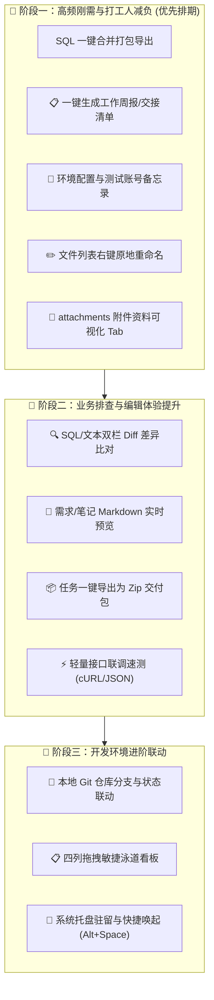

# 🚀 DevOrbit (DevTaskHub) 功能规划与技术路线图 (Roadmap & Backlog)

> **软件定位**：个人开发者专属的本地优先 (Local-First) 工作台，针对企业级实际业务开发痛点，提供任务分级归档、SQL 脚本发布追踪、Office 原生免损打开、随手记及全方位提效工具。

---

## 📊 迭代矩阵与功能拆解

---

## 🥇 阶段一：高频刚需与打工人减负（第一优先级）

| 功能模块 | 痛点分析 | 核心设计与交互 | 技术实现要点 (Vue 3 + Electron) | 预计复杂度 |
| :--- | :--- | :--- | :--- | :---: |
| **1. SQL 一键合并打包导出** | 一个任务包含 5~11 份 SQL，给 DBA 或部署发版时需要手动打开文件一个个复制代码，极易漏发或顺序搞错。 | 在「SQL 脚本」页面顶部增加 **【一键合并导出】** 按钮： 1. 弹出浮层列出所有/已勾选脚本，支持拖拽调整执行次序； 2. 自动生成标准注释头（作者、任务名、时间戳、文件来源）； 3. 可选是否包裹 `START TRANSACTION; ... COMMIT;` 事务； 4. 支持 **【一键复制到剪贴板】** 或另存为 `00_merged_all.sql`。 | **主进程**：拼接文本并写入指定路径； **渲染层**：`TaskDetailModal.vue` 增加合并弹窗与顺序调节。 | 🟢 较低 (0.5 人天) |
| **2. 一键生成周报 / 发版交接清单** | 周五写周报或版本交接时，到处翻找本周做过了什么需求、改了哪些 SQL、联调结论是什么。 | 顶部导航栏增加 **【📋 生成周报/汇总】** 按钮： 1. 自动过滤本周有变动（`mtime` 或 `createdAt`）的任务； 2. 按项目/分类聚合任务标题、状态、SQL 发布记录； 3. 提取「笔记.md」中的关键备忘，生成规整的 Markdown/纯文本； 4. 提供「一键复制」按钮，可直接粘贴进企业微信/钉钉/飞书/邮件。 | **数据源**：扫描当前工作区所有任务的 `task.json` 与修改时间； **组件**：新增独立周报弹窗 `WeeklyReportModal.vue`。 | 🟢 较低 (0.5 人天) |
| **3. 任务专属环境配置与账号备忘录** | 每个需求任务对应的测试环境 IP、Swagger 地址、测试账号、Token 散落在聊天记录中，切回任务时需反复找人要。 | 在任务详情中增加 **「环境与账号卡片」（参数小抽屉）**： 1. 字段支持：测试环境 URL、服务端口、测试账号、登录密码、联调 Token/Cookie、备注； 2. 每个字段右侧配备 **【一键直拷】** 按钮； 3. 密码字段支持一键眼睛图标明文切换。 | **存储**：直接序列化存放在 `task.json` 的 `envParams` 字段中，纯本地保存无外泄风险。 | 🟢 较低 (0.5 人天) |
| **4. 文件列表支持「右键重命名 (Rename)」** | 拖入或新建的文档名称有错别字或需改版本号时，必须退出软件到 Windows 文件资源管理器去改，体验打断。 | 在需求、笔记、SQL 列表项上右键呼出菜单中，增加 **【重命名】** 选项： 1. 原地切换为输入框（类似 VS Code 重命名交互）； 2. 自动校验文件名非法字符（如 `\/:*?"<>|`）； 3. 若修改的是 SQL 文件，自动同步更新 `task.json` 中的 `sqlReleaseRecords` 映射。 | **主进程**：`fs.renameSync`； **状态同步**：重命名后自动刷新文件列表与发布状态。 | 🟢 较低 (0.5 人天) |
| **5. 附件与资料可视化板块 (`attachments/` 支持)** | 原型设计图（PNG/JPG）、泛微流程压缩包（.zip）、测试样本等非文本文件，缺少专门的直观呈现与查看器。 | 在任务详情顶部增加第 4 个 Tab **【4. 附件资料 (attachments)】**： 1. 卡片/网格展示图片预览图与文件图标； 2. 图片支持点击内置简易灯箱放大浏览； 3. 其它压缩包/安装包支持一键唤起系统默认打开方式或直接定位文件夹。 | **依赖**：利用 Electron 原生 `shell.openPath` 与图片 Base64/本地协议直显。 | 🟡 中等 (1 人天) |

---

## 🥈 阶段二：业务排查与编辑体验提升

| 功能模块 | 痛点分析 | 核心设计与交互 | 技术实现要点 | 预计复杂度 |
| :--- | :--- | :--- | :--- | :---: |
| **6. SQL / 文本即时双栏对比 (Side-by-Side Diff)** | 对比修改前后的 SQL 脚本或两版接口设计文档极其费眼，经常漏看改动的一个字段。 | 支持按住 `Ctrl` 勾选 2 个文件，右键选择 **【两文件差异对比】**： 1. 呼出全屏/大弹窗双栏对比器； 2. 红绿色彩标记新增行、删除行与行内字符级变更； 3. 支持切换 Split（左右双栏）与 Unified（单列上下）视图。 | **方案推荐**：引入轻量成熟库 `diff` + `diff2html` 或 Monaco Editor Diff，零服务端依赖。 | 🟡 中等 (1~1.5 人天) |
| **7. 需求与笔记 Markdown 实时渲染预览** | 编辑大段需求 PRD 或排版表格时只能看原生 Markdown 标记，不直观。 | 在内置文本编辑器右上方增加 **【编辑 / 预览】** 或 **【左右分屏】** 切换按钮： 1. 实时解析 Markdown 标题、任务勾选框、代码高亮、表格与引用框； 2. 支持直接点击预览区内的超链接外链呼出系统浏览器。 | **方案**：使用 `markdown-it` + `highlight.js`，轻量且样式可深度融入当前的暗黑主题。 | 🟡 中等 (1 人天) |
| **8. 任务一键打包归档 (Zip 交付包)** | 需求上线后向运维、测试交付完整包，或自己备份留档时，需要手动去目录压缩。 | 任务卡片右键菜单增加 **【导出为独立交付 Zip 包】**： 1. 自动打包 `docs/`、`sql/`、`attachments/`； 2. 自动剔除临时文件与系统垃圾（如 `.DS_Store`、Thumbs.db）； 3. 自动命名为 `${项目名}_${年份}_${任务名}_交付包.zip` 并弹出保存对话框。 | **主进程**：集成 `adm-zip` 或 `archiver`，流式压缩写盘，无需外部 WinRAR/7-Zip。 | 🟢 较低 (0.5 人天) |
| **9. 极简接口联调速测 (轻量 cURL / JSON 响应查看器)** | 联调短信、OA、单点登录接口时，打开庞大的 Postman 占用内存过大、启动缓慢。 | 任务侧边抽屉内置极简 HTTP 客户端： 1. 支持 Method（GET/POST/PUT/DELETE）、URL、Headers、Body； 2. 支持粘贴 cURL 命令行自动反向解析为表单； 3. 响应结果提供 JSON 树形折叠高亮与一键复制。 | **通信**：主进程通过 `net` / `fetch` 发出请求，天然规避浏览器端的跨域（CORS）拦截问题。 | 🟡 中等 (1.5 人天) |

---

## 🥉 阶段三：开发环境进阶联动（生态闭环）

| 功能模块 | 痛点分析 | 核心设计与交互 | 技术实现要点 | 预计复杂度 |
| :--- | :--- | :--- | :--- | :---: |
| **10. 本地代码 Git 仓库与分支联动** | 做多个需求任务时，经常忘记当前任务对应本地哪个 Git 代码仓库与分支。 | 任务设置中可绑定本地代码工程目录（如 `D:\repo\mz-backend`）： 1. 卡片小标签直接显示当前 Git 分支名（如 `feature/2026-auth`）； 2. 悬浮提示有无未提交代码（Uncommitted Changes: 3）； 3. 点击直接调起已配置的 VS Code / IDEA 打开对应工程。 | **底层**：主进程使用已安装的 `git status` / `git branch --show-current` 执行轻量检测。 | 🟡 中等 (1 人天) |
| **11. 看板模式切换 (网格卡片 vs 四列拖拽泳道看板)** | 传统网格列表按时间排序，缺乏敏捷项目全景流转视角。 | 顶部提供视图切换开关（网格卡片 / 敏捷看板）： 1. 四列泳道：`开发中` → `联调测试` → `待上线` → `已归档`； 2. 鼠标长按任务卡片，直接拖拽到目标列实现状态自动持久化。 | **推荐**：使用 `vuedraggable` (基于 SortableJS)，操作跟手顺滑。 | 🟡 中等 (1.5 人天) |
| **12. 系统托盘驻留与全局快捷唤起 (Alt + Space)** | 日常写代码时，想要临时记一条命令或查 SQL，在多窗口中来回切换效率较低。 | 1. 点击右上角关闭按钮可选「最小化到系统右下角托盘」； 2. 全局热键唤起（默认 `Alt + Space` 或 `Ctrl + Shift + O`），屏幕中央瞬时浮出窗口； 3. 再次按下快捷键或点击外部空白区自动隐退。 | **Electron API**：`globalShortcut.register`、`Tray`、`BrowserWindow.hide/show`。 | 🟢 较低 (0.5 人天) |

---

## 💡 落地实施推荐路径（最强 ROI 组合）

若准备开启下一轮开发，推荐优先实现 **阶段一的 3 大神器**，性价比极高且立竿见影：
1. **SQL 一键合并导出**（发版不再费神拼接 SQL）
2. **一键生成周报 / 交付交接单**（彻底告别周五找记录写周报的痛苦）
3. **环境配置与测试账号备忘录（参数小抽屉）**（随时一键复制 Token 与测试 IP）
